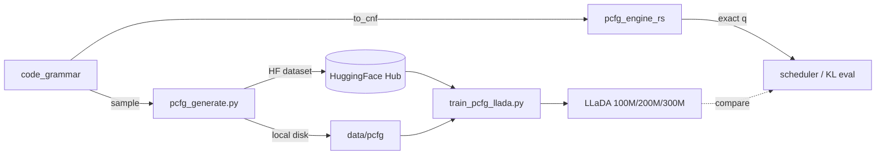

# LLaDALens

LLaDALens is a controlled synthetic domain inside Strace for training and evaluating small **LLaDA** (masked diffusion) models on **PCFG-generated code-like strings**. Because the data comes from a known probabilistic grammar, you can compute **exact token marginals** \(q(x_p \mid \text{visible tokens})\) via a Rust CKY inside/outside engine — a ground-truth oracle for scheduler research and model calibration.

---

## Why it exists

| Problem in natural-language eval | LLaDALens answer |
| -------------------------------- | ---------------- |
| Unknown true conditional distributions | Exact \(q\) from the PCFG engine |
| Expensive / noisy ground truth | Fast Rust CKY with incremental `PCFGState` |
| Hard to isolate scheduler errors | Infinite synthetic corpus with fixed syntax |
| Large-model training cost | 100M–300M LLaDA variants on 51-token vocab |

Use LLaDALens to prototype schedulers, measure KL to ground truth, and train small diffusion LMs before scaling to GSM8K / HumanEval runs in the main Strace harness.

---

## Layout

```
lladalens/
├── pcfg_grammar.py      # Grammar, CNF conversion, Rust sampler
├── pcfg_generate.py     # Corpus generation + HF export
├── pcfg_data.py         # Vocab, LLaDA masking, inference inputs
├── pcfg_engine.py       # Python API over Rust CKY engine
├── pcfg_engine_rs/      # Rust inside/outside + PyO3 bindings
├── pcfg_validate.py     # Engine speed benchmarks
├── hf_hub.py            # HuggingFace Hub helpers (Strace conventions)
├── train_pcfg_llada.py  # End-to-end training script
└── models/              # LLaDA config, model, tokenizer, variants
```

---

## Prerequisites

| Requirement | Why |
| ----------- | --- |
| Python ≥ 3.10 | `pyproject.toml` constraint |
| `numpy`, `datasets` | Corpus I/O |
| `maturin` + Rust toolchain | Build `pcfg_engine_rs` |
| `torch` (optional) | Training only (`pip install -e ".[train]"` from `lladalens/`) |
| `HF_TOKEN` | Hub push/load (set in `.env` or via `repo_env_defaults`) |

Run scripts from `lladalens/` unless noted otherwise.

---

## Setup

### Python dependencies

```bash
cd lladalens
pip install -e .
pip install -e ".[train]"   # for training
pip install -e ".[hub]"     # for Hub push (huggingface_hub)
```

### Rust extension (`pcfg_engine_rs`)

`pcfg_engine_rs` is the native extension (PyO3 bindings) with two components:

| Component | Python API | Role |
| --------- | ---------- | ---- |
| CKY inside/outside | `pcfg_engine.PCFGEngine` | Exact marginals \(q(x_p \mid \text{visible})\), `Z`, `Mt`, `Jt` |
| Parallel sampler | `pcfg_grammar.Sampler` | Corpus generation via `PyPCFGSampler` (rayon-parallel) |

Build from `lladalens/`:

```bash
cd lladalens
pip install maturin
maturin develop --release
```

Verify:

```bash
python -c "from pcfg_engine import PCFGEngine; from pcfg_grammar import Sampler; print('ok')"
```

Usage:

```python
from pcfg_engine import PCFGEngine          # CKY marginals
from pcfg_grammar import Sampler, code_grammar   # corpus generation
from pcfg_engine_rs import PyPCFGSampler    # low-level Rust API

g = code_grammar()
engine = PCFGEngine(g.to_cnf())
sampler = Sampler(g, workers=8)
batch = sampler.sample_batch(1000, 64, 128, seed=0)
```

CKY runs entirely in Rust. Corpus sampling uses `PyPCFGSampler` (rayon-parallel threads).

---

## Grammar

`code_grammar()` in `pcfg_grammar.py` defines a C-like PCFG with ~48 terminals (`int`, `if`, `while`, `id`, `num`, `+`, …) and nonterminals (`Prog`, `Stmt`, `Expr`, `Cond`, …).

| Property | Value |
| -------- | ----- |
| String length range | 64–128 tokens |
| Sequence architecture length | 128 (`ARCH_LEN`) |
| Vocab size | 51 (`<pad>`, `<mask>`, `<eos>` + terminals) |

The `Grammar` class defines `code_grammar()` rules. `to_cnf()` converts automatically (fresh start, terminal lifting, binarization, unit-rule elimination) so the CKY engine can consume the grammar. Corpus sampling is implemented in Rust via `Sampler` in the same module.

---

## Data generation

`pcfg_generate.py` samples strings until a train token budget is met, optionally holds out a fixed number of test strings (disjoint shuffle split), and saves a HuggingFace `DatasetDict`.

### Local only

```bash
cd lladalens
python pcfg_generate.py --train-tokens 500000 --test-strings 512 --out-dir data/pcfg
```

### Push to HuggingFace Hub

```bash
# Short name → resolves to <namespace>/pcfg-code via whoami or env
python pcfg_generate.py --train-tokens 1000000 --test-strings 1000 --dataset pcfg-code --push

# Full repo id
python pcfg_generate.py --train-tokens 1000000 --test-strings 1000 --repo-id devichand/pcfg-code --push

# Explicit namespace
python pcfg_generate.py --train-tokens 500000 --dataset pcfg-code --namespace devichand --push
```

### Fast generation (Rust sampler)

Build `pcfg_engine_rs`, then generate with parallel Rust sampling (default):

```bash
python pcfg_generate.py --train-tokens 100000000 --test-strings 512 \
  --workers 8 --dataset pcfg-code --push
```

Observed throughput: **~3–4M tokens/sec**. 100M tokens ≈ **30–60 seconds** of sampling.

### Generation flags

| Flag | Description |
| ---- | ----------- |
| `--train-tokens` | Train split token budget (after test holdout) |
| `--test-strings` | Strings held out from pool for test |
| `--min-len`, `--max-len` | Length range (default 64–128) |
| `--seed` | Sampling seed |
| `--workers` | Rust sampler threads (default: CPU count, max 8) |
| `--progress-interval` | Log every N pool tokens (default 250000; 0 to disable) |
| `--out-dir` | Local `save_to_disk` path (default `data/pcfg_corpus`) |
| `--no-save` | Skip local save |
| `--dataset` | Short Hub dataset name (default `pcfg-code`) |
| `--repo-id` | Full `org/repo` (overrides `--dataset`) |
| `--namespace` | HF org when using a short name |
| `--push` | Push to Hub after generation |
| `--private` | Create private dataset repo |
| `--capacity` | Print grammar capacity notes before sampling |

### Dataset schema

Each split has rows with:

| Field | Type | Description |
| ----- | ---- | ----------- |
| `id` | int | Row index |
| `tokens` | list[str] | Grammar terminal sequence |
| `length` | int | `len(tokens)` |
| `text` | str | Space-joined tokens |

`generation_meta.json` is written alongside the local export with split stats and sampling parameters.

---

## HuggingFace integration

`hf_hub.py` follows the same conventions as trace uploads and CST hidden storage:

- `apply_repo_env_defaults()` — sets `HF_TOKEN` from `.env` / repo defaults
- `normalize_dataset_repo_id()` — resolves short names to `org/repo`
- `ensure_dataset_repo()` — creates the dataset repo before push

### Environment variables

| Variable | Default | Purpose |
| -------- | ------- | ------- |
| `HF_TOKEN` | from `.env` | Hub authentication |
| `PCFG_HF_DATASET` | `pcfg-code` | Default short dataset name |
| `PCFG_HF_NAMESPACE` | — | Default org (else `TRACE_HF_NAMESPACE` / whoami) |

### Load corpus in Python

```python
from pcfg_data import load_corpus_from_hub

train, test, ddict = load_corpus_from_hub("pcfg-code")
# or
train, test, ddict = load_corpus_from_hub("devichand/pcfg-code")
```

---

## Training

`train_pcfg_llada.py` trains small LLaDA variants with **independent masking** (LLaDA Eq. 3):

1. Draw \(t \sim \text{Uniform}[0, 1]\) per example
2. Mask each content token independently with probability \(t\)
3. Optimize CE on masked positions with weight \(1 / (t \cdot L)\)

### Model variants

| Variant | d_model | layers | ~params |
| ------- | ------- | ------ | ------- |
| `100m` | 768 | 12 | 85M |
| `200m` | 1024 | 16 | 218M |
| `300m` | 1024 | 24 | 327M |

Load programmatically:

```python
from lladalens.pcfg_models import load_pcfg_llada, load_pcfg_tokenizer

model, config, vocab = load_pcfg_llada("100m")
tokenizer = load_pcfg_tokenizer()
```

### Train from local corpus

```bash
cd lladalens
python train_pcfg_llada.py --variant 100m --corpus data/pcfg --epochs 1 --steps 200
```

### Train from Hub

```bash
python train_pcfg_llada.py --variant 100m --hf-dataset pcfg-code --steps 200
```

### Train on-the-fly sampling

```bash
python train_pcfg_llada.py --variant 100m --train-tokens 500000 --steps 200
python train_pcfg_llada.py --variant 100m --n-examples 2048 --steps 50   # legacy count API
```

### Training flags

| Flag | Description |
| ---- | ----------- |
| `--variant` | `100m` / `200m` / `300m` |
| `--corpus` | Local `save_to_disk` path from `pcfg_generate` |
| `--hf-dataset` | Hub dataset (short name or `org/repo`) |
| `--hf-namespace` | Org override for short `--hf-dataset` |
| `--train-tokens` | Sample corpus by token budget |
| `--n-examples` | Legacy: exact string count |
| `--batch-size` | Default 16 |
| `--peak-lr`, `--mid-lr`, `--min-lr` | WSD schedule (paper defaults) |
| `--steps` | Cap optimizer steps |
| `--out-dir` | Checkpoint output (default `checkpoints/llada-<variant>-pcfg`) |

Checkpoints include model weights, config, tokenizer, and `pcfg_vocab.txt`.

---

## PCFG engine (ground truth)

The Rust engine (`pcfg_engine_rs`) runs CKY inside/outside on the CNF grammar. Python access is via `pcfg_engine.py`.

### Build the stack

```python
from pcfg_data import build_stack, infer_marginals

g, cnf, engine, vocab = build_stack()
```

### Exact marginals

```python
tokens = [...]  # grammar string, len 64–127
ex = infer_marginals(engine, tokens, n_visible=32, vocab=vocab)

# ex.marginals[pos] → np.ndarray over terminals (sums to 1)
for pos, dist in ex.marginals.items():
    print(pos, dist.argmax(), dist.max())
```

### Key engine methods

| Method | Computes |
| ------ | -------- |
| `Z(L, committed)` | Partition function (parse probability) |
| `marginals_batch(L, committed, positions)` | \(q(x_p \mid \text{committed})\) per position |
| `all_marginals(L, committed)` | All positions at once |
| `Jt_entropy(L, committed, S)` | Joint entropy over masked set \(S\) |
| `Mt(L, committed, S, model_fn)` | KL divergence vs model predictions |
| `make_state` / `PCFGState.commit` | Incremental chart updates for scheduler simulation |

### Benchmarks

```bash
cd lladalens
python pcfg_validate.py
python pcfg_validate.py --lengths 32 64 128 --jt-sizes 3 4 5
```

---

## End-to-end workflow



1. **Generate** — `pcfg_generate.py --train-tokens … --dataset pcfg-code --push`
2. **Train** — `train_pcfg_llada.py --variant 100m --hf-dataset pcfg-code`
3. **Evaluate** — compare model logits to `infer_marginals()` at masked positions; plug `PCFGState` into scheduler unmasking loops

---

## Relation to Strace

| Strace component | LLaDALens role |
| ---------------- | -------------- |
| `schedulers/` | Test unmasking order against exact \(q\) |
| `schedulerlens/` | M̂/Ĵ metrics with known ground-truth marginals |
| `traces/` | Same HF conventions for dataset push/load |
| `models/llada/` | Full-scale 8B model; LLaDALens uses small PCFG-tuned copies |

LLaDALens is the **synthetic sandbox**: infinite known data, exact conditionals, small fast models — before running the full eval harness on real benchmarks.

---

## Troubleshooting

| Issue | Fix |
| ----- | --- |
| `ImportError: pcfg_engine_rs is required` | Run `maturin develop --release` from `lladalens/` |
| `no namespace` on Hub push | Set `--namespace`, `PCFG_HF_NAMESPACE`, or `huggingface-cli login` |
| `content length must be < arch_len` | Grammar strings must be ≤ 127 tokens (room for `<eos>`) |
| Training loss uses wrong formula | Do not use HF `labels` in `LLaDAModelLM.forward`; use `llada_mask_loss` in the training script |
| Slow marginal queries | Use `marginals_batch` or incremental `PCFGState` instead of recomputing full charts |
